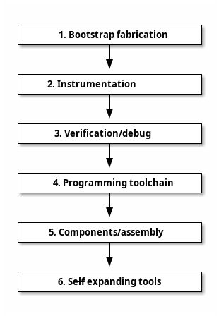

# Developer Tools Roadmap

> **Status:** This is the current best guess, not a commitment or prediction. The roadmap is
speculative and may change radically as the science and technology develop.

The goal is a self-enabling toolchain: use molecular systems to build better ways to design,
produce, measure, debug, and combine molecular systems. Tools are the first application; a low-cost
molecular printer is one possible early capability, not the end goal.

## Roadmap

The phases describe dependencies, not a fixed schedule. Modeling and verification can begin with
existing tools.

### 1. Bootstrap fabrication

Produce simple, measurable molecular devices through a repeatable, low-cost workflow. Evaluate
production methods without making any one method a prerequisite.

Generative optogenetics is an ambitious research hypothesis for light-directed DNA or RNA synthesis
in cells. It could inform a production platform, but it is not yet a general-purpose molecular
printer. Existing synthesis, assembly, and lab equipment can support early work.

**Milestone:** Produce a small library of characterized devices with documented protocols, identity,
yield, reproducibility, and cost.

### 2. Instrumentation and feedback

Add sample tracking, calibration, suitable readout, experiment logging, and feedback into later
runs.

**Milestone:** Run a repeatable design–produce–measure loop that distinguishes production failures
from device failures.

### 3. Verification and debugging

Compare expected and observed behavior to find design, fabrication, environmental, or measurement
errors. Build static checks, simulations, physical tests, fault localization, and regression tests.

**Milestone:** Given a failed experiment, narrow its likely causes rather than only report failure.

### 4. Molecular programming toolchain

Compile behavior-level designs into physical implementations. Keep an intermediate representation
independent of particular mechanisms, so implementations can change as methods improve.

**Milestone:** Compile a small program, check it before fabrication, and test the device against its
specification.

### 5. Reusable components and assembly

Create characterized component libraries, interface contracts, assembly planners, system-level
models, and integration tests. Fabricating components and assembling them are separate problems.

**Milestone:** Assemble validated modules into a larger system with predictable behavior.

### 6. Self-expanding infrastructure

Use molecular devices and automated design–build–test loops to improve the reliability, capability,
or cost of later development. This may remain a hybrid of molecular devices, robotics, optics, and
software; it does not require tools to manufacture themselves.

**Milestone:** Demonstrate a development cycle in which one generation of tools measurably improves
the next.

## Development stack

| Embedded systems | Molecular programming |
| --- | --- |
| Board fabrication | Molecular production and assembly |
| Test boards and microcontrollers | Standard substrates and test devices |
| Drivers and firmware | Reaction protocols and low-level control |
| Debug probes | Assays and molecular-state readout |
| Simulators and verification | Reaction and structural models; formal analysis |
| Compilers and SDKs | Molecular languages, compilers, and libraries |
| Reusable hardware IP | Characterized components and validated modules |
| Hardware-in-the-loop tests | Closed-loop experimental validation |

The analogy has limits: molecular systems are noisy, stochastic, and chemically coupled.
Verification must account for physical conditions and measurement uncertainty.

## Progress gates

Advance by demonstrated capability, not by commitment to a particular technology:

1. **Reproducible construction:** Can devices with known properties be made at predictable cost and
   success rates?
2. **Measurable behavior:** Can the system quantify deviations and help explain failures?
3. **Compositional reuse:** Can characterized components be combined without losing predictability?

These gates keep progress useful even if a proposed fabrication method fails.

## Research links

Link each phase to canonical research topics rather than duplicating them here.

| Phase | Primary areas |
| --- | --- |
| Bootstrap fabrication | Dynamics, Interfaces |
| Instrumentation and feedback | Dynamics, Interfaces |
| Verification and debugging | Dynamics, Circuits, Systems |
| Programming toolchain | Circuits, Dynamics |
| Components and assembly | Systems, Circuits, Dynamics |
| Self-expanding infrastructure | Systems, Interfaces |

Build the minimum useful toolchain first. Let each generation reduce the cost and uncertainty of
developing the next.
