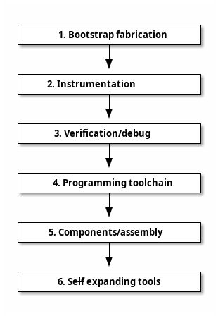

# Developer Tools Roadmap {#mpkb:section:sec-0019}

> **Status:** This is the current best guess, not a commitment or prediction. The roadmap is
speculative and may change radically as the science and technology develop.

The roadmap has two purposes: Show which tools are available now to develop molecular-programming
applications, and identify missing tools that would remove important barriers. Prioritize missing
tools by application need and by whether a useful version is realistically achievable next. The
[software tools catalog](software_tools.md) and [hardware tools catalog](hardware_tools.md) record
existing tools; this roadmap describes the gaps and the capabilities that can address them.

The highest-priority application will always be the next generation of tools that improve ways to design,
produce, measure, debug, and combine molecular systems.

## Roadmap {#mpkb:section:sec-0020}

The phases describe dependencies, not a fixed schedule. Each phase should make clear what existing
tools can support the work, what important capability is missing, and what achievable next step would
close that gap. Modeling and verification can begin with existing tools.

### Near-term next steps {#mpkb:section:sec-1051}

Start with one small application and a tool-supported workflow. Do not begin by building a general
platform.

1. **Audit the current tool set.** Review the [software tools catalog](software_tools.md) and
   [hardware tools catalog](hardware_tools.md). For each candidate, record its purpose, inputs,
   outputs, access conditions, maintenance status, and known limitations. Treat catalog entries as
   candidates to verify, not endorsements or proof that a tool is currently operational.
2. **Choose a benchmark application.** A small DNA strand-displacement logic circuit is a useful
   candidate because this repository already covers [strand-displacement tools](software_tools.md#mpkb:section:sec-0035),
   [DNA/RNA logic gates](../research_topics/circuits/dna_rna_logic_gates.md), and [strand displacement](../research_topics/circuits/dna_strand_displacement.md).
   Define the expected input/output behavior, operating conditions, and a measurable pass/fail
   criterion before fabrication.
3. **Connect design to measurement.** Identify a tool for sequence or structure design, a method to
   predict behavior, a fabrication protocol, and an assay that reads the benchmark output. Use the
   [tutorial collection](tutorials.md) and [interfaces and experimental methods](../research_topics/interfaces/index.md)
   to locate candidate methods. Record missing steps instead of assuming one tool covers the whole
   workflow.
4. **Create a reproducible experiment record.** For each run, retain the design file and version,
   tool versions, sequences or component definitions, protocol, materials, reaction conditions,
   instrument settings, controls, raw measurements, analysis, and deviations. Keep raw observations
   separate from interpretations.
5. **Repeat and diagnose.** Run enough controls and repeats to distinguish design failure, production
   failure, environmental effects, and measurement failure. Use the results to revise the design or
   protocol, then repeat the same benchmark.
6. **Rank tool gaps.** For each gap, state who needs it, what task it blocks, the smallest useful
   capability, a prototype that can test it, estimated effort or dependencies, and relevant safety or
   operating constraints. Prioritize high-need gaps with a credible near-term prototype over broad
   speculative platforms.

**Near-term completion gate:** another contributor can use the documented workflow to reproduce the
benchmark, compare measured behavior with the prediction, and identify the next tool gap from recorded
evidence.

### 1. Bootstrap fabrication {#mpkb:section:sec-0021}

Produce simple, measurable molecular devices through a repeatable, low-cost workflow. Evaluate
production methods without making any one method a prerequisite.

Generative optogenetics is an ambitious research hypothesis for light-directed DNA or RNA synthesis
in cells. It could inform a production platform, but it is not yet a general-purpose molecular
printer. Existing synthesis, assembly, and lab equipment can support early work.

**Milestone:** Produce a small library of characterized devices with documented protocols, identity,
yield, reproducibility, and cost.

**Next step:** start with the benchmark and experiment record in [Near-term next steps](#mpkb:section:sec-1051).
Use the existing [DNA and RNA nanotechnology catalog](software_tools.md#mpkb:section:sec-0034) to find
design and analysis candidates, then record where laboratory fabrication or characterization is still
missing. See [DNA origami](../research_topics/structures_and_dynamics/dna_origami.md) and
[DNA nanostructure assembly](../research_topics/structures_and_dynamics/self_assembling_dna_nanostructures.md)
for related structural workflows.

### 2. Instrumentation and feedback {#mpkb:section:sec-0022}

Add sample tracking, calibration, suitable readout, experiment logging, and feedback into later
runs.

**Milestone:** Run a repeatable design–produce–measure loop that distinguishes production failures
from device failures.

**Next step:** define the readout and controls for the benchmark before the first run. Select
measurement methods from [atomic-scale research tools](../research_topics/interfaces/atomic_scale_tools.md)
or [molecular sensors](../research_topics/interfaces/molecular_sensors.md) only when they measure the
chosen output; document what each method cannot resolve.

### 3. Verification and debugging {#mpkb:section:sec-0023}

Compare expected and observed behavior to find design, fabrication, environmental, or measurement
errors. Build static checks, simulations, physical tests, fault localization, and regression tests.

**Milestone:** Given a failed experiment, narrow its likely causes rather than only report failure.

**Next step:** separate checks into design constraints, predicted behavior, protocol execution,
sample quality, environmental conditions, and measurement validity. Add a regression case for each
failure that has a known correction. Use [stochastic modeling](../research_topics/theoretical_foundations/chemical_reaction_networks/stochastic_modeling.md)
and [molecular noise](../research_topics/theoretical_foundations/molecular_noise.md) when variability
is part of the expected system behavior, not just an unexplained error.

### 4. Molecular programming toolchain {#mpkb:section:sec-0024}

Compile behavior-level designs into physical implementations. Keep an intermediate representation
independent of particular mechanisms, so implementations can change as methods improve.

**Milestone:** Compile a small program, check it before fabrication, and test the device against its
specification.

**Next step:** keep the first intermediate representation narrow: define components, connections,
inputs, outputs, and operating conditions for the benchmark. Compare predicted circuit behavior with
measurements before adding code generation or support for more mechanisms. The [circuit topic area](../research_topics/circuits/index.md)
provides the current design context.

### 5. Reusable components and assembly {#mpkb:section:sec-0025}

Create characterized component libraries, interface contracts, assembly planners, system-level
models, and integration tests. Fabricating components and assembling them are separate problems.

**Milestone:** Assemble validated modules into a larger system with predictable behavior.

**Next step:** define module interfaces and acceptance tests for one pair of characterized modules.
Record which conditions preserve behavior when modules are combined. Do not build a general component
registry until multiple projects need the same descriptions and validation rules.

### 6. Self-expanding infrastructure {#mpkb:section:sec-0026}

Use molecular devices and automated design–build–test loops to improve the reliability, capability,
or cost of later development. This may remain a hybrid of molecular devices, robotics, optics, and
software; it does not require tools to manufacture themselves.

**Milestone:** Demonstrate a development cycle in which one generation of tools measurably improves
the next.

**Next step:** consider this phase only after earlier gates have evidence. Start with a bounded
automation task, such as selecting among tested designs or adjusting an experimental parameter within
validated limits. Keep human review, containment, and stop conditions explicit.

## Development stack {#mpkb:section:sec-0027}

| Embedded systems | Molecular programming |
| --- | --- |
| Board fabrication | Molecular production and assembly |
| Test boards and microcontrollers | Standard substrates and test devices |
| Drivers and firmware | Reaction protocols and low-level control |
| Debug probes | Assays and molecular-state readout |
| Simulators and verification | Reaction and structural models; formal analysis |
| Compilers and SDKs | Molecular languages, compilers, and libraries |
| Reusable hardware IP | Characterized components and validated modules |
| Hardware-in-the-loop tests | Closed-loop experimental validation |

The analogy has limits: molecular systems are noisy, stochastic, and chemically coupled.
Verification must account for physical conditions and measurement uncertainty.

## Progress gates {#mpkb:section:sec-0028}

Advance by demonstrated capability, not by commitment to a particular technology:

1. **Reproducible construction:** Can devices with known properties be made at predictable cost and
   success rates?
2. **Measurable behavior:** Can the system quantify deviations and help explain failures?
3. **Compositional reuse:** Can characterized components be combined without losing predictability?

These gates keep progress useful even if a proposed fabrication method fails.

## Research links {#mpkb:section:sec-0029}

Link each phase to canonical research topics rather than duplicating them here.

| Phase | Primary areas |
| --- | --- |
| Bootstrap fabrication | Dynamics, Interfaces |
| Instrumentation and feedback | Dynamics, Interfaces |
| Verification and debugging | Dynamics, Circuits, Systems |
| Programming toolchain | Circuits, Dynamics |
| Components and assembly | Systems, Circuits, Dynamics |
| Self-expanding infrastructure | Systems, Interfaces |

Build the minimum useful toolchain first. Let each generation reduce the cost and uncertainty of
developing the next.
